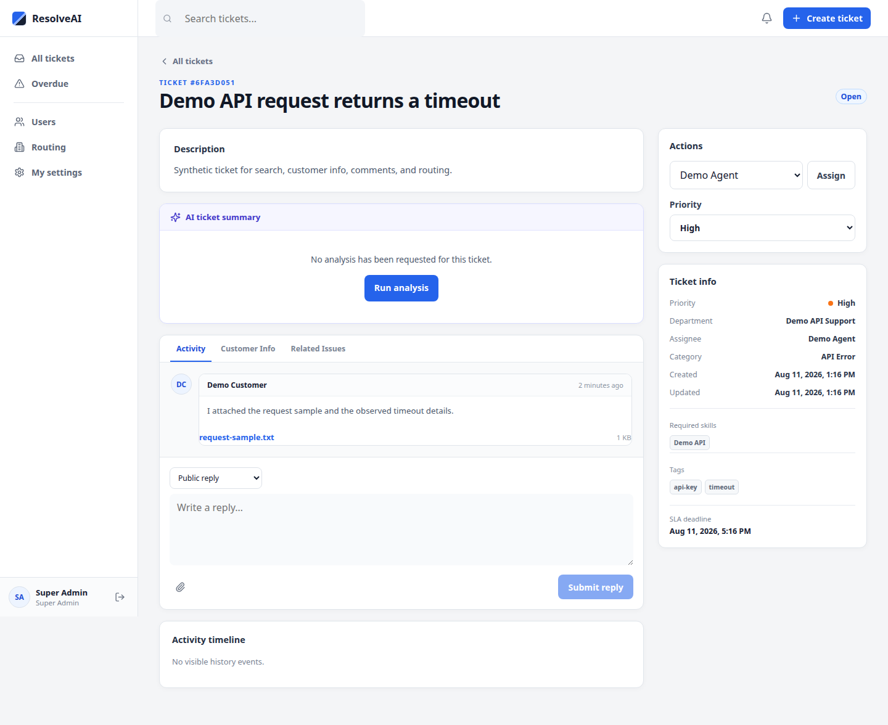

# ResolveAI — AI-Oriented Customer Support Ticket System

Backend-first FastAPI project for a customer support platform: users, JWT
authentication, role-based permissions, ticket workflows, comments, automatic
agent routing, SLA deadlines, Redis caching/rate limiting, RQ background jobs,
and AI-assisted ticket summarization (fake, OpenRouter, or direct DeepSeek). A
Vite/React/TypeScript staff workspace in `site/` talks to the real API.



The screenshot uses synthetic local demo data. Acceptance evidence is recorded
in [docs/ACCEPTANCE.md](docs/ACCEPTANCE.md).

## Tech Stack

- Python, FastAPI, Pydantic, SQLAlchemy, Alembic
- PostgreSQL (Docker) / SQLite (tests, quick local runs)
- Redis, RQ (workers + cron scheduler)
- JWT (RS256) with refresh-token sessions, bcrypt password hashing
- OpenRouter and direct DeepSeek Chat Completions via `httpx`
- Pytest; React, TypeScript, Vite, Vitest
- Docker and Docker Compose

## Quick Start (Docker)

On a fresh checkout, create the local configuration and an RSA key pair for
JWT access tokens:

```bash
cp .env.example .env
mkdir -p keys
umask 077
openssl genpkey -algorithm RSA -pkeyopt rsa_keygen_bits:2048 -out keys/private.pem
openssl pkey -in keys/private.pem -pubout -out keys/public.pem
```

Set `POSTGRES_PASSWORD` and the `SUPERADMIN_*` values in `.env`. Also set a
private random `REFRESH_TOKEN_SECRET`; generate one with `openssl rand -hex 32`.
Keep `.env` and `keys/private.pem` out of Git and screenshots. If this
installation used JWT keys before, restore the original pair instead of
generating a new one. New keys invalidate existing access tokens.

Start PostgreSQL, Redis, migrations, the API, worker, cron, and frontend:

```bash
./project.sh
```

Then open `http://localhost:5173` (frontend) or `http://localhost:8000/docs`
(API docs). The launcher builds the images, starts every service in the
background, waits for the stack to become healthy, and creates the configured
superadmin automatically when the database has no users. On later starts it
verifies the persisted administrator without overwriting it. It does not delete
or reset PostgreSQL data.

```bash
./project.sh status   # show every container and its health
./project.sh logs     # follow combined logs; Ctrl+C only stops viewing logs
./project.sh stop     # stop services and preserve the database volume
```

## Running Locally (bare metal)

Requires five processes: Redis, the API, an RQ worker, RQ cron, and Vite.

```bash
# .env: copy .env.example; the database seeds the safe fake provider selection
# Redis must be running at REDIS_URL=redis://localhost:6379/0.

redis-server                                            # 1
myvenv/bin/python -m uvicorn main:app --reload          # 2
myvenv/bin/rq worker ticket_routing ticket_jobs \
  --url redis://localhost:6379/0                        # 3 (routing first = priority)
myvenv/bin/rq cron src/jobs/cron.py \
  --url redis://localhost:6379/0                        # 4

cd site && npm install && cp .env.example .env && npm run dev   # 5
```

Open `http://127.0.0.1:5173`. Create the initial superadmin once with
`myvenv/bin/python bootstrap_superadmin.py` (requires `SUPERADMIN_*` env vars).

## Tests

```bash
REDIS_ENABLED=false myvenv/bin/python -m pytest -q  # isolated backend tests
cd site && npm test -- --run && npm run build        # frontend
cd .. && myvenv/bin/ruff check main.py src scripts bootstrap_superadmin.py
```

The backend tests disable Redis deliberately because they use isolated test
fixtures. The running local application still requires Redis, as shown in
`.env.example`.

## Use the direct DeepSeek API

Put your DeepSeek API key in `DEEPSEEK_API_KEY` in your private `.env` file.
Recreate the API and RQ worker containers with
`docker compose up -d --force-recreate api worker`, or restart both bare-metal
processes, so they load the key. In the staff workspace, sign in as Admin or
Super Admin, open **AI settings**, choose
**Direct DeepSeek** and `deepseek-flash`, then run **Test provider** with its
fixed synthetic ticket. If the test succeeds, choose **Save selection**.
New analyses use DeepSeek; analyses already queued keep the provider and model
recorded when they were requested. Keep real customer data out of external
provider tests unless you have permission to send it.

The selection is stored in the database. Changing `ANALYZER_PROVIDER` alone
does not switch the staff workspace's active provider. OpenRouter remains
available as a separate option.

## API Overview

- **Users** — register, list, get, update, agent availability/profile, soft delete
- **Auth** — `POST /auth/login`, `/auth/refresh`, `/auth/logout`; Bearer JWT
- **Tickets** — SQL-backed search/filter/pagination, My Queue, claim/assign/
  start-work, comments, ticket-scoped customer info, related issues, and
  durable AI analysis results
- **AI settings** — Admin/Super Admin-only global provider/model selection for
  fake, OpenRouter, and direct DeepSeek; provider keys never cross the API
- **Staff workspace** — role-aware Users, Routing catalogs, My Settings, agent
  availability, secure comment attachments, and recipient-only notifications
- **Jobs** — background job status and listing

Errors use a shared envelope: `{ "error": { "code", "message" } }`.

## Detailed documentation

- [Architecture](docs/ARCHITECTURE.md)
- [Permissions](docs/PERMISSIONS.md)
- [Ticket workflow](docs/TICKET_WORKFLOW.md)
- [API examples](docs/API_EXAMPLES.md)
- [Reliability and security](docs/RELIABILITY.md)
- [Attachment contract](docs/ATTACHMENTS.md)
- [Final v1 acceptance evidence](docs/ACCEPTANCE.md)

## Repository Structure

```text
main.py                 FastAPI app entrypoint
Dockerfile / compose.yaml   Full-stack deployment
alembic/                PostgreSQL schema migrations
src/routers/            API route handlers
src/services/           Business logic and permissions
src/db/                 SQLAlchemy engine, models, operations
src/models/             Pydantic request/response models
src/core/               Security, config, logging
src/jobs/               RQ queues, worker tasks, cron
src/analyzers/          Fake, OpenRouter, and DeepSeek analyzers
src/cache/              Redis helpers
src/tests/              Pytest suite
site/                   Vite/React frontend (see site/README.md)
```

## How It Works

Synchronous requests follow `router -> auth dependency -> service -> database`.
Two flows cross a process boundary through Redis/RQ:

- **Routing**: a classified ticket (`department_id` set) is enqueued on
  `ticket_routing`; a worker assigns it to the eligible least-loaded agent in
  one idempotent database transaction. RQ cron re-enqueues tickets whose
  enqueue failed earlier.
- **Analysis**: the current database selection is snapshotted into a durable
  PENDING row before enqueue, processed on `ticket_jobs` by the selected fake,
  OpenRouter, or direct DeepSeek adapter, and stored as COMPLETED/FAILED — SQL
  is the source of truth, not the RQ job.

Redis also provides ticket-detail caching (SQL fallback on failure) and login
rate limiting (fails closed). SLA deadlines combine status base hours with a
priority multiplier; a periodic scanner records one overdue event per ticket.

The deterministic fake analyzer is the default verified local-demo provider.
OpenRouter and direct DeepSeek require external keys. This closure pass
live-tested direct DeepSeek with synthetic data only. OpenRouter live testing
was explicitly waived; its adapter and automated tests remain covered.
OpenRouter keeps its configured ZDR/data-collection controls. ResolveAI makes
no equivalent request-level ZDR claim for direct DeepSeek.
